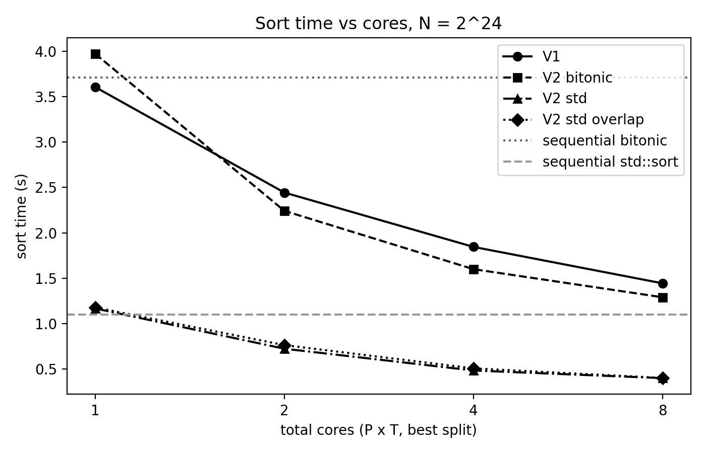
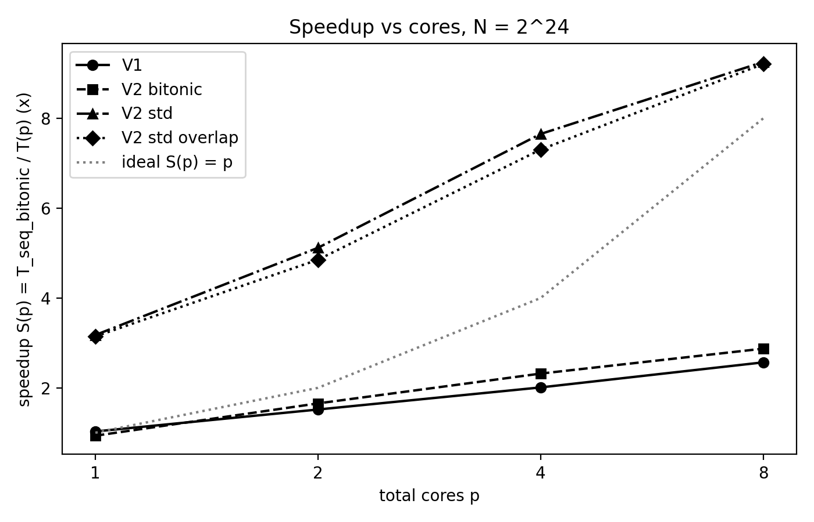
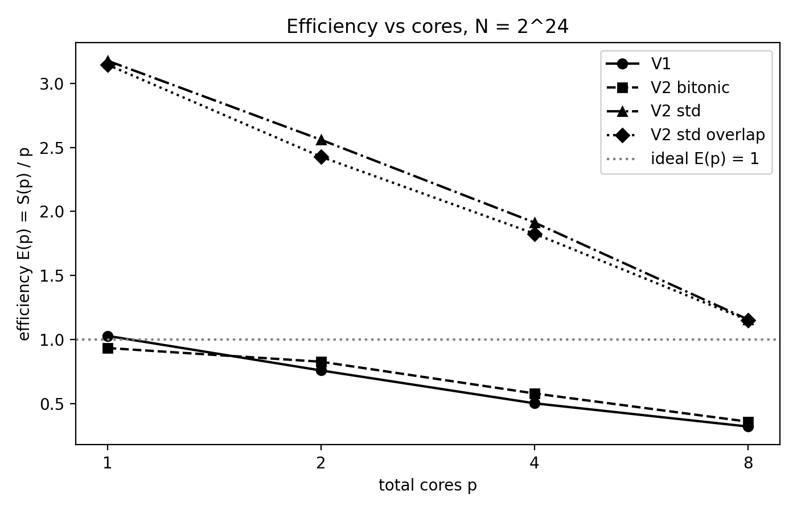
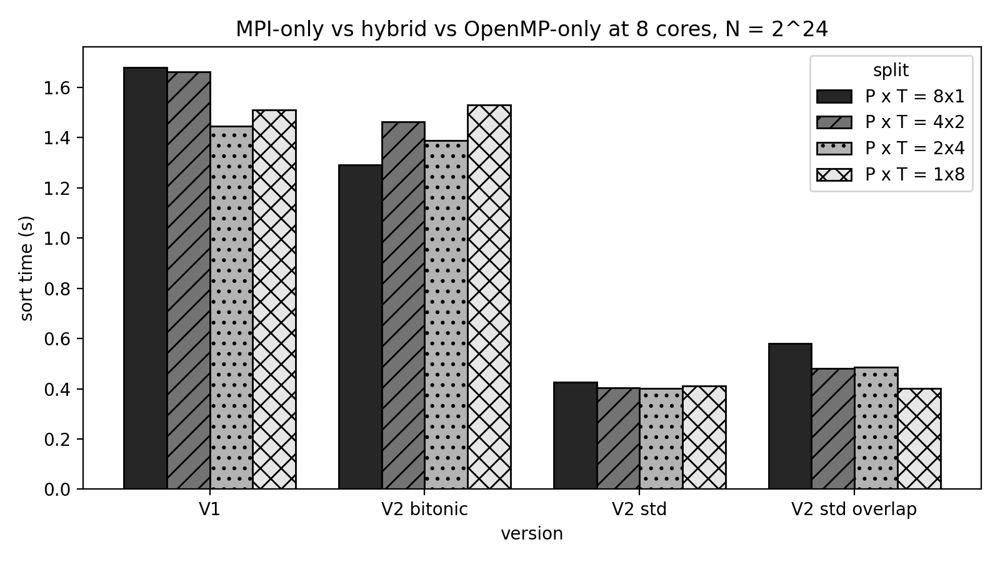
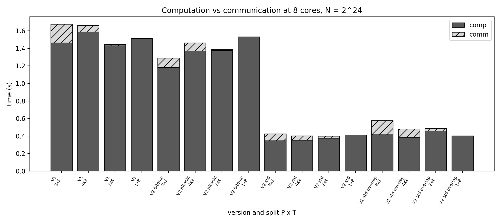
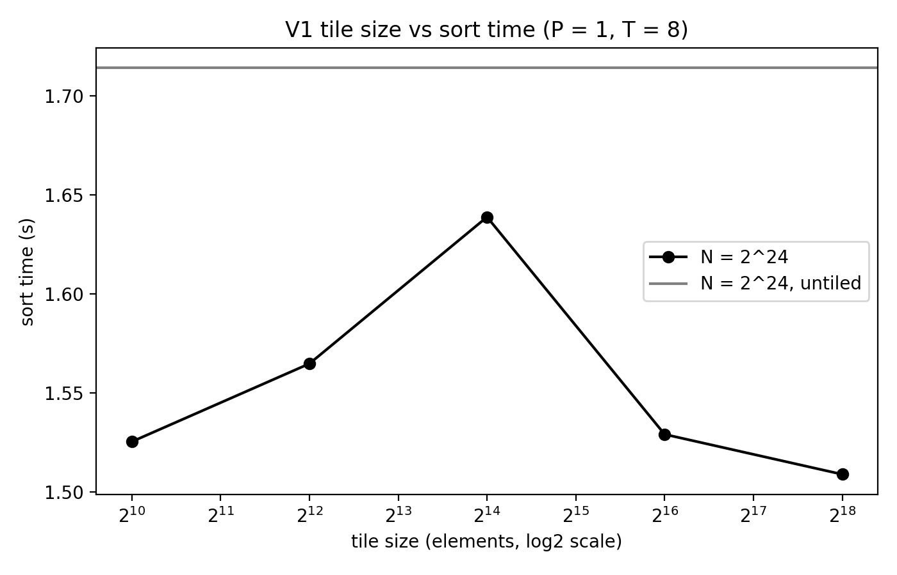
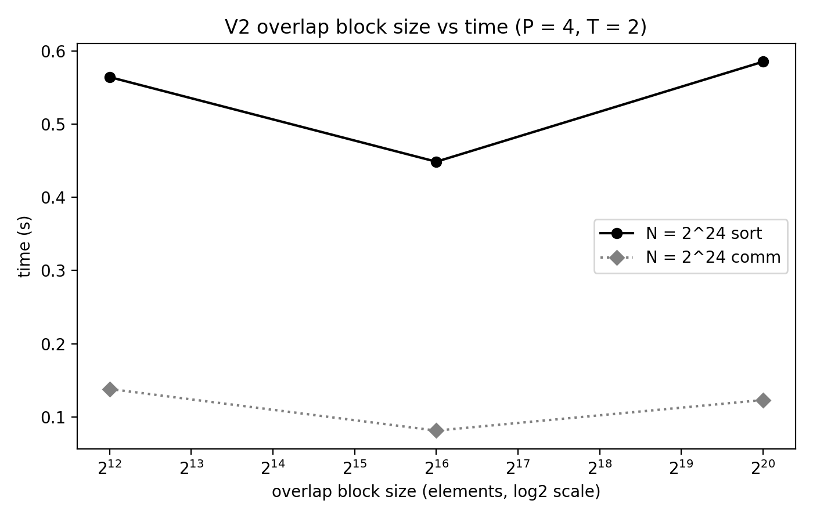

# Parallel Bitonic Sort on a Large Array using Hybrid MPI and OpenMP

> **Provisional numbers.** Every timing in this report comes from a **quick benchmark run** (`scripts/run_benchmarks.sh --quick`: N = 2^24 only, 2 runs per configuration) on a **4-core laptop running Windows 11 with MS-MPI**, not on the lab machine. They show that the pipeline works end to end and give first trends only. Replace every number, table and plot with the output of a full run on the lab machine before submission. Sizes 2^26, 2^27 and 2^28 were **not measured**.

## 1. Introduction and objective

Sorting is a basic building block of many data-processing pipelines. Comparison sorts such as quicksort, merge sort and `std::sort` are efficient on one core, but their data-dependent control flow is hard to distribute evenly. A sorting network fixes the whole sequence of compare-exchange operations in advance, whatever the input. Every stage is a set of independent operations, which makes it a natural fit for parallel hardware.

This project implements Batcher's bitonic sort for large arrays of 32-bit unsigned integers on a hybrid parallel model:

- **MPI** covers distributed memory. The array is split into P equal chunks, one per process.
- **OpenMP** threads inside each process share the work on that process's chunk.

The goals are:

1. Build a correct sequential baseline and two hybrid versions.
2. Measure computation and communication separately.
3. Compare MPI-only, OpenMP-only and hybrid splits of the same core count.
4. Explain where and why speedup flattens.

## 2. Bitonic sort recap

A sequence is *bitonic* if it first increases and then decreases, or is a cyclic rotation of such a sequence. A *bitonic merge* of length k turns a bitonic sequence into a sorted one in log2 k steps. In step j (j = k/2, k/4, ..., 1), element i is compare-exchanged with element i XOR j. Bitonic sort first builds bitonic sequences of length 2, 4, 8, ... and merges them, alternating the direction so that each pair of sorted halves forms a bitonic sequence of twice the length.

For N = 2^m elements the network has

- an outer phase for each k = 2, 4, ..., N (m phases);
- inside phase k, log2 k stages (j = k/2 down to 1);
- in total m(m+1)/2 = log2N (log2N + 1)/2 stages, each with exactly N/2 independent compare-exchanges.

The total work is O(N log² N) comparisons. Comparison sorts need O(N log N), so on one core bitonic sort does more work than `std::sort`. Its advantage is that every stage parallelises perfectly, with no data-dependent branching in the schedule. For N = 2^24 there are 24·25/2 = 300 stages.

The direction of a compare-exchange is ascending when `(i & k) == 0`. The partner of i is `i XOR j`. Both formulas assume N is a power of two. The data decomposition then needs P to be a power of two as well, so that every chunk boundary is aligned with the network's power-of-two block structure. Only then does each stage map onto whole chunks, either entirely inside one rank or between exactly two ranks.

The implementation iterates over *pairs* rather than over all indices. Pair number p maps to its lower index with `i = ((p & ~(j-1)) << 1) | (p & (j-1))`, and its partner is `l = i + j`. This avoids the half-idle loop of the naive "for every i, if partner > i" formulation.

## 3. Parallel design

### 3.1 Data decomposition and generation

The global array of N elements is split into P chunks of n = N/P elements. Rank r owns the global indices [r·n, (r+1)·n). Data comes from a counter-based generator:

`value(seed, g) = upper 32 bits of splitmix64(seed + g · 0x9E3779B97F4A7C15)`

Every element depends only on the seed and its **global** index g, so the global input array is the same for every P and every thread count. The sequential baseline and every parallel configuration therefore sort exactly the same data, and full verification can regenerate the expected input on rank 0. Generation runs in parallel with OpenMP and is timed separately as `init`.

### 3.2 Hybrid V1: global network with local and remote stages

V1 runs the full global bitonic network, with directions computed from global indices.

- **Local stages (j < n).** Both partners lie inside the same chunk. OpenMP threads split the n/2 pairs with `#pragma omp for schedule(static)`. Each pair is touched by exactly one thread, so no locks are needed.
- **Remote stages (j ≥ n).** The partner element lies in another rank's chunk at the same local position. The partner rank is `rank XOR (j / n)`. The whole chunk is exchanged with `MPI_Sendrecv`. With `ascending = (offset & k) == 0`, the rank keeps the elementwise minimum when `(rank < partner) == ascending` and the maximum otherwise.

The whole network runs inside **one** `omp parallel` region using orphaned `omp for` loops, so threads are not created again for each of the 300 stages. Under `MPI_THREAD_FUNNELED` only the master thread calls MPI (`#pragma omp master`), followed by an explicit barrier before the threads apply min or max.

### 3.3 Cache tiling

For a fixed k, every stage with j < tile only compares elements inside the same aligned block of `tile` elements. The tiled kernels exploit this:

- `omp_local_full_sort_phase` sorts each tile completely (all k ≤ tile) with one parallel loop over tiles. Directions still come from global indices.
- `omp_local_merge_steps` runs the stages with j ≥ tile as full-chunk passes. It then runs every remaining stage with j < tile tile by tile, so a tile stays in cache for log2(tile) consecutive stages instead of streaming the whole chunk once per stage.

`--tile 0` turns tiling off. The effective tile is clamped to min(tile, n).

### 3.4 Hybrid V2: local sort plus merge-split

V2 first sorts each chunk locally in ascending order, then runs a bitonic network over the **ranks**. Each node of that network is a whole sorted chunk.

- **Local sort.** Either the tiled bitonic kernels with local directions (`--local-sort bitonic`), or a parallel `std::sort` (`--local-sort std`). The std variant sorts T equal parts in parallel and merges them pairwise in ceil(log2 T) parallel rounds, alternating between the chunk and a scratch buffer.
- **Merge-split.** For k = 2..P and j = k/2..1, partner = `rank XOR j`, `ascending = (rank & k) == 0`, and the rank keeps the low half when `(rank < partner) == ascending`. Partners swap whole chunks. The keep-low side keeps the n smallest of the 2n elements and the keep-high side keeps the n largest, so both stay sorted ascending.
- **Merge path.** The merge-split is parallelised with merge-path partitioning. Thread t produces outputs [t·n/T, (t+1)·n/T) of the selected half. It finds its starting split of the two inputs by a binary search along the diagonal and then merges its segment independently. The keep-high side uses the same forward merge starting at diagonal n, which produces exactly the n largest elements.

**Message count.** V2 does **not** send fewer messages than V1. Both versions perform log2P(log2P+1)/2 full-chunk exchange rounds. For P = 8 that is 6 rounds in V1 (the remote stages with j ≥ n) and 6 rounds in V2, and each round moves n elements in each direction. The benefit of V2 is elsewhere: the local phase can use an O(n log n) sort instead of O(n log² n) bitonic stages, and each remote round costs one linear merge instead of an elementwise pass followed by log2 n local stages.

### 3.5 Overlapped exchange (V2 `--overlap`)

In overlapped mode the chunk is exchanged in blocks of B elements with `MPI_Isend`/`MPI_Irecv`. All receives are posted first, then all sends. Send order matches how the partner consumes the data:

- The keep-low rank merges from the **front**, so its partner (the keep-high side) sends its blocks first to last.
- The keep-high rank merges from the **back**, so the keep-low side sends its blocks last to first.

The master thread runs a streaming two-pointer merge. When the pointer into the partner's data reaches a block that has not yet been marked as arrived, it calls `MPI_Wait` on that block. Only the time spent inside MPI calls is counted as communication. With `MPI_THREAD_FUNNELED` only the master thread may wait, so this merge is serial. The parallel merge-path version stays the default, and both modes give identical output.

### 3.6 Timing

- `init`: data generation.
- `comm`: time inside MPI exchange calls (`MPI_Sendrecv`, `MPI_Isend`/`MPI_Irecv` posting and waits).
- `comp`: the rest of the sort phase.
- Sort time = comp + comm. It excludes init and verification, which happen outside the barriers that bracket the sort.
- Each component is reduced with `MPI_MAX` over ranks.
- Speedup S(p) = T(1)/T(p), with T(1) = the median sequential bitonic time. Efficiency E(p) = S(p)/p.

Deviation from the plan: the timer uses `std::chrono::steady_clock` instead of `omp_get_wtime`. On the MinGW/Windows toolchain used here, `omp_get_wtime` has only 1 ms resolution, which would distort the sum of many short per-exchange comm intervals.

## 4. Experimental setup

Values gathered on the machine that produced the quick results:

| Item | Value |
|---|---|
| CPU | 11th Gen Intel Core i7-1165G7 @ 2.80 GHz |
| Cores | 4 physical cores, 8 logical processors (Hyper-Threading) |
| Caches | L2 5120 KB total, L3 12288 KB |
| RAM | 15.7 GB |
| OS | Microsoft Windows 11 Pro (no WSL; native build) |
| Compiler | g++ 15.2.0 (MSYS2 UCRT64), via `mpicxx` |
| Flags | `-std=c++17 -O3 -march=native -fopenmp -Wall -Wextra` |
| MPI | Microsoft MPI 10.1.12498.52 (`mpiexec`) |
| Python | 3.13.9, pandas 2.3.3, matplotlib 3.10.6 |
| Pinning | none: on MS-MPI the script only sets `OMP_NUM_THREADS`; no process or thread binding |
| Benchmark | `--quick`: N = 2^24, 2 runs per configuration, median reported, `--verify fast` |

Core counts up to 8 were tested, but only 4 of those are physical cores. Results at 8 "cores" therefore include Hyper-Threading effects. A laptop CPU also changes its turbo frequency with load and temperature. On the lab machine, `scripts/run_benchmarks.sh` uses Open MPI (`--map-by slot:PE=T --bind-to core`, `OMP_PROC_BIND=close`, `OMP_PLACES=cores`) or MPICH (`-bind-to core:T`) pinning. This section must then be regenerated from `lscpu`, `mpirun --version` and `g++ --version` on that machine.

## 5. Correctness methodology and results

There are two verification modes:

- **Full** (N ≤ 2^22). The distributed result is gathered on rank 0 and compared element by element with `std::sort` of the regenerated input. In `seq_main`, the bitonic result is compared with the `std::sort` result.
- **Fast** (any N):
  - every rank checks that its chunk is sorted;
  - neighbours exchange boundary values (last element of rank r against first element of rank r+1);
  - the checksums (sum and sum of squares, both 64-bit with wraparound) taken before and after the sort are reduced over all ranks and compared.

`scripts/test_correctness.sh` covers:

- full verification for exp ∈ {16, 18, 20} of `seq_main`;
- `hybrid_v1` for P ∈ {1,2,4,8}, T ∈ {1,2,4} and tile ∈ {0, 1024, 4096};
- `hybrid_v2` for P ∈ {1,2,4,8}, T ∈ {1,2,4} and local sort ∈ {bitonic, std}, each with overlap off and with overlap on at block 1024;
- fast-verified runs at exp 24 with P = 4, T = 2.

**Result: 258 cases, 258 PASS, 0 FAIL, 0 SKIP.** No combination needed skipping, because N/P ≥ 2 holds throughout. During development, V2 was also full-verified with overlap blocks of 65536 and 1048576 (64 cases, all PASS). Every benchmark run also passed fast verification.

## 6. Results (quick run, N = 2^24)

Sequential baselines (median of 2 runs): sequential bitonic **3.708 s**, `std::sort` **1.099 s**.

### 6.1 Best configuration per version (`results/summary.csv`)

| Version | Best P x T | t_comp (s) | t_comm (s) | t_sort (s) | Speedup vs seq bitonic | Efficiency |
|---|---|---|---|---|---|---|
| V2 std | 2 x 4 | 0.377 | 0.024 | 0.401 | 9.26 | 1.16 |
| V2 std overlap | 1 x 8 | 0.403 | 0.000 | 0.403 | 9.21 | 1.15 |
| seq std::sort | 1 x 1 | 1.099 | 0.000 | 1.099 | 3.37 | 3.37 |
| V2 bitonic | 8 x 1 | 1.183 | 0.108 | 1.291 | 2.87 | 0.36 |
| V1 | 2 x 4 | 1.429 | 0.015 | 1.444 | 2.57 | 0.32 |
| seq bitonic | 1 x 1 | 3.708 | 0.000 | 3.708 | 1.00 | 1.00 |

The best "V2 std overlap" configuration is 1 x 8. With a single process there is no exchange at all, so that row is effectively V2 std. The "speedup" and "efficiency" of the std-based variants are measured against the sequential **bitonic** baseline, as the project definition requires. Values above p therefore reflect the lower O(n log n) work of `std::sort`, not a superlinear parallel effect.

### 6.2 Selected medians by split (N = 2^24, sort time in seconds)

| Cores | Split | V1 | V2 bitonic | V2 std | V2 std overlap |
|---|---|---|---|---|---|
| 1 | 1x1 | 3.605 | 3.972 | 1.167 | 1.179 |
| 2 | 1x2 | 2.444 | 2.358 | 0.724 | 0.766 |
| 2 | 2x1 | 2.482 | 2.243 | 0.811 | 0.764 |
| 4 | 1x4 | 1.961 | 1.884 | 0.493 | 0.508 |
| 4 | 2x2 | 1.846 | 1.619 | 0.485 | 0.511 |
| 4 | 4x1 | 1.848 | 1.600 | 0.506 | 0.607 |
| 8 | 1x8 | 1.511 | 1.531 | 0.411 | 0.403 |
| 8 | 2x4 | 1.444 | 1.389 | 0.401 | 0.485 |
| 8 | 4x2 | 1.662 | 1.464 | 0.403 | 0.482 |
| 8 | 8x1 | 1.678 | 1.291 | 0.425 | 0.581 |

V1 communication time grows with P at T = 1: 0.019 s (P = 2), 0.085 s (P = 4) and 0.214 s (P = 8).

### 6.3 Plots

Tile sweep (V1, P = 1, T = 8, N = 2^24, median sort time):

| Tile | 0 (untiled) | 1024 | 4096 | 16384 | 65536 | 262144 |
|---|---|---|---|---|---|---|
| t_sort (s) | 1.714 | 1.525 | 1.565 | 1.639 | 1.529 | 1.509 |

Block sweep (V2 std overlap, P = 4, T = 2, N = 2^24):

| Block | 4096 | 65536 | 1048576 |
|---|---|---|---|
| t_comm (s) | 0.138 | 0.082 | 0.123 |
| t_sort (s) | 0.564 | 0.449 | 0.585 |

Results for N = 2^26, 2^27 and 2^28: **not measured**.

## 7. Analysis

The observations below refer to this quick run only and must be re-checked against the lab-machine data.

**Where speedup flattens.**

- V1 scales from 3.605 s on one core to 1.961 s on 4 cores (1x4), an efficiency of about 0.46 relative to its own single-core time. Going to 8 logical cores adds only a little more (1.444 s at best).
- V2 bitonic behaves the same way. Its best 8-core speedup over sequential bitonic is 2.87 (efficiency 0.36).
- The curve flattens beyond 4 cores mainly because the machine has only 4 physical cores. Hyper-threads share each core's execution units and caches and contribute little to a streaming, memory-bound kernel.

**Memory bandwidth.** Every stage of the untiled network reads and writes the whole array once: 300 stages × 64 MB of data at N = 2^24. Each compare-exchange is a min and a max, so arithmetic intensity is very low and the kernel is limited by memory bandwidth once a few cores are active. Adding threads beyond the bandwidth limit does not help, which matches the modest gain from 4 to 8 threads.

**Tiling.** At T = 8, tiling cut V1 time from 1.714 s untiled to between 1.509 s and 1.639 s, a gain of roughly 4–12%. The curve is not monotonic in tile size. With two runs per point on a laptop with variable turbo, the differences between tile sizes from 1024 to 262144 are within the noise. In an earlier ad-hoc run with T = 4, the larger tiles were slower than untiled. The lab run with more repetitions should decide whether a clear optimum exists. Tiling only helps the stages with j < tile; the stages with large j still stream the whole chunk.

**Cost of far-stage exchanges.**

- In V1 each remote stage moves the whole chunk both ways. The number of such stages, log2P(log2P+1)/2, grows with P.
- At T = 1, V1 comm time rose from 0.019 s (P = 2) to 0.214 s (P = 8). At P = 8 it is about 13% of the 1.678 s sort time.
- On this single machine MPI moves data through shared memory, so the comm cost is mostly memory copies. Across real network links on a cluster, the same volume would cost much more.

**MPI-only vs OpenMP-only vs hybrid.**

- At 8 cores the best V1 split was the hybrid 2x4 (1.444 s), ahead of OpenMP-only 1x8 (1.511 s) and MPI-only 8x1 (1.678 s). MPI-only pays the most exchanges; OpenMP-only pays for having every thread in one large shared address space.
- For V2 bitonic, MPI-only 8x1 was fastest (1.291 s). There the network over ranks replaces many bitonic stages with a few linear merges.
- For V2 std all splits were within about 6% of each other (0.401–0.425 s).
- These rankings are sensitive to the lack of pinning on Windows and should be re-measured with pinning on the lab machine.

**V1 vs V2.**

- With the same bitonic local work, V2 bitonic was faster than V1 at most core counts (e.g. 1.291 s vs 1.444 s at the best 8-core split).
- The big difference comes from the local sort. V2 with parallel `std::sort` reached 0.401 s, about 3.6 times faster than the best V1.
- V2 does **not** reduce the number of exchange rounds (6 for P = 8 in both versions). Its advantage is purely in computation.

**Overlap.**

- Blocked non-blocking exchange **did not help** here. At 8 cores, overlap gave 0.485 s (2x4), 0.482 s (4x2) and 0.581 s (8x1), against 0.401 s, 0.403 s and 0.425 s without overlap.
- First reason: under `MPI_THREAD_FUNNELED` the streaming merge runs on the master thread only, so it gives up the T-way parallel merge path.
- Second reason: the shared-memory exchange is already cheap, so there is little latency to hide.
- The block sweep found 65536 to be the best block size of the three tested (0.449 s, vs 0.564 s at 4096 and 0.585 s at 1048576). Small blocks pay per-message overhead; very large blocks leave little to overlap.

## 8. Limitations and future work

- **Provisional data.** Only N = 2^24 with 2 runs was measured, on a 4-core laptop under Windows with MS-MPI and without pinning. The full study (N up to 2^27 and 2^28 where memory allows, 5 runs, pinned) has to be run on the lab machine.
- **Single node.** All MPI traffic went through shared memory. A multi-node run would show the true cost of chunk exchanges.
- **Serial overlap merge.** With `MPI_THREAD_MULTIPLE`, or a dedicated communication thread, the streaming merge could be parallelised.
- **Vectorisation.** A blocked compare-exchange layout (contiguous runs of j elements) would let the compiler use SIMD min/max for large j. Small j could use in-register sorting networks.
- **Power-of-two restriction.** N and P must be powers of two. Padding with sentinel values would remove this restriction.
- **Memory.** V2 needs about 3n elements per rank (chunk, receive buffer, scratch). V1 needs 2n.

## 9. Conclusion

The project delivers a sequential bitonic baseline and two hybrid MPI + OpenMP bitonic sorts.

- V1 runs the full global network with lock-free OpenMP stages and `MPI_Sendrecv` chunk exchanges, plus optional cache tiling.
- V2 sorts each chunk locally and runs a merge-split bitonic network over the ranks, with a merge-path parallel merge and an optional block-pipelined non-blocking exchange.

All 258 correctness cases pass. On the quick run, the hybrid V1 split 2x4 beat both pure MPI and pure OpenMP. V2 with a parallel `std::sort` local phase was the fastest variant, at 0.401 s against 3.708 s for sequential bitonic. Overlapped exchange did not pay off on shared memory. Scaling flattens beyond the 4 physical cores because the network is memory-bound. All numbers above are provisional and must be replaced by a full run on the lab machine.
